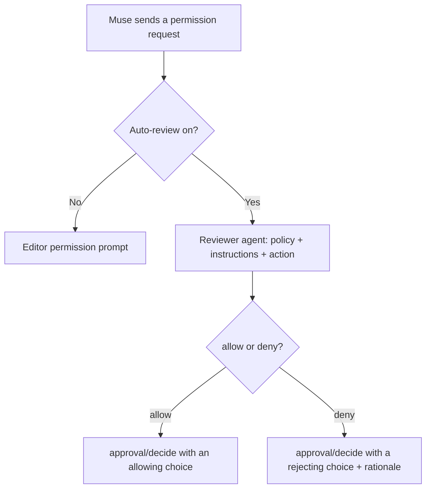

# muse-acp

**Use your existing Muse Code subscription in Zed, JetBrains IDEs, and any other
ACP client.**

[](https://github.com/BrokkAi/muse-acp/actions/workflows/ci.yml)
[](https://github.com/BrokkAi/muse-acp/releases/latest)
[](LICENSE)
[](https://www.rust-lang.org/)

`muse-acp` is a bridge between editors that speak the
[Agent Client Protocol](https://agentclientprotocol.com/) (ACP) and
[Muse Code](https://dev.meta.ai/docs/muse-code). It talks to Muse over its
native [Muse Session Protocol](https://github.com/meta-models/muse-code-sdk)
(MSP), so your subscription keeps Muse's own session engine, tools,
authentication, and approval flow.

The adapter is one small Rust binary with no runtime dependencies. It supports
ACP v1 and v2, and installs on macOS, Linux, and Windows.

Client implementers should start with the
[ACP extension contract](docs/acp-extensions.md). It lists every negotiated
Muse method, `_meta` shape, capability, fallback, and the ACP standard fields
used where they exist.

The workspace also contains a reusable synchronous ACP SDK for both sides of
the protocol, [`acp-lite`](crates/acp-lite/README.md). Its client side can
launch any ACP stdio agent, negotiate ACP v1 or v2, stream session updates,
and route agent requests such as permissions and elicitation through a
configurable handler. Its agent side answers a client's requests and batches,
streams notifications, and matches the agent's own requests to the client with
their answers. It is independent of the adapter binary and of the upstream
`agent-client-protocol` Rust crate.

Toward Muse, the adapter speaks MSP through
[`muse-msp-client`](crates/muse-msp-client/README.md), a dependency-free
synchronous client that launches a configured `muse serve`, performs the
handshake, correlates requests, routes server requests, and shuts the host
down within a bounded time. Tools that need Muse sessions without ACP can use
it directly.

> `muse-acp` is an independent community project. Muse Code and Muse Spark are
> products of Meta Platforms, Inc. This project is not affiliated with,
> endorsed by, or supported by Meta.

## Auto-review: let an agent decide every prompt

Muse Code's own `:auto-review` permission profile is a TUI feature. Under
`muse serve`, a saved `:auto-review` session falls back to asking you for
everything, so editor users choose between clicking through every prompt or
switching to `allowAll` and giving up review entirely. `muse-acp` gives you
the middle path: a per-session **Auto-review** selector that sends every
permission request to a reviewer agent instead of to you.

The reviewer is a second Muse model session on its own memory-only, read-only
host (`--no-session-log`), so reviews are never saved and never touch your
files. It gets the same kind of input Codex's guardian gets: a fixed safety
policy, your trusted instructions, recent evidence, and the exact approval
request. It ends its answer with one verdict line, `ALLOW: <why>` or
`DENY: <why>`. Low and medium risk actions proceed; critical risk is denied;
high risk proceeds only when your instructions authorize it. A reply without
a verdict is asked again up to three times; a reviewer failure, or still no
verdict, denies the action rather than letting it run. Denials are shown in the editor transcript with the specific
reason, and every decision is logged to stderr with its rationale.



Auto-review is off by default. Turn on the **Auto-review** toggle (ACP v2,
or ACP v1 clients that advertise
`clientCapabilities.session.configOptions.boolean`) or select **On** in the
**Auto-review** selector (other ACP v1 clients), next to Approval Mode in
clients that render ACP `configOptions`, and it applies to that session only. See the
[Auto-review guide](docs/auto-review.md) for the policy, the reviewer's
inputs, the decision thresholds, and the failure behavior.

## Requirements

- **Muse Code** installed, authenticated, and available as `muse` on `PATH`.
- A **stdio ACP client**: Zed, a JetBrains IDE with AI Assistant, or another
  ACP client such as [micro-acp](https://github.com/BrokkAi/micro-acp).
- **Node.js 22+** if you install from npm.
- **Rust 1.88+** if you build from source.

## Quick start

### 1. Install Muse Code

Install Muse and log in before installing the adapter:

```sh
curl -fsSL https://dev.meta.ai/install.sh | sh
muse login
```

On macOS you can also use Homebrew:

```sh
brew install --cask muse-code
```

Confirm `muse --version` works, then continue.

### 2. Install muse-acp

With Node.js 22 or later, install from npm:

```sh
npm install -g @brokkai/muse-acp
muse-acp --selftest
```

Or run it without a global install:

```sh
npx --yes @brokkai/muse-acp --selftest
```

The npm package bundles the native binaries for every supported platform, so it
needs no install scripts or separate downloads.

> The package is the scoped `@brokkai/muse-acp`. The unscoped `muse-acp`
> package on npm is a different, unrelated project, so `npm install -g
> muse-acp` installs someone else's adapter.

On Linux and macOS you can install the latest release instead:

```sh
curl --proto '=https' --tlsv1.2 -LsSf \
  https://github.com/BrokkAi/muse-acp/releases/latest/download/install.sh | sh
```

The installer detects your platform, verifies the archive's SHA-256 checksum,
and installs `muse-acp` to `~/.local/bin`. Pin a version or choose another
absolute destination with environment variables on `sh`:

```sh
curl --proto '=https' --tlsv1.2 -LsSf \
  https://github.com/BrokkAi/muse-acp/releases/latest/download/install.sh \
  | MUSE_ACP_INSTALL_DIR="$HOME/bin" MUSE_ACP_VERSION=vX.Y.Z sh
```

On Windows x86_64 or arm64, run the PowerShell installer for the MSVC release:

```powershell
irm https://github.com/BrokkAi/muse-acp/releases/latest/download/install.ps1 | iex
```

It picks the build for the machine's architecture, even from an emulated x64
PowerShell on arm64, verifies the ZIP's SHA-256 checksum, and installs
`muse-acp.exe` to `$env:LOCALAPPDATA\Programs\muse-acp`, leaving `PATH`
untouched. Set `MUSE_ACP_VERSION` or `MUSE_ACP_INSTALL_DIR` to pin a version or
choose another absolute directory, then add the reported directory to your user
`PATH`.

From a checkout, build and install with Cargo:

```sh
cargo install --path .
```

### 3. Connect your editor

```sh
muse-acp install            # Zed
muse-acp install-intellij   # IntelliJ IDEA and other JetBrains IDEs
```

Both commands are safe to re-run: they preserve existing agent entries, write a
`.bak` backup, and replace the settings file atomically. Use `--dry-run` to
preview an edit.

Any other ACP client can launch `muse-acp` directly over stdio.

## Editor setup

### Zed

`muse-acp install` registers the adapter in Zed's settings file,
`~/.config/zed/settings.json` (`%APPDATA%\Zed\settings.json` on Windows):

```json
{
  "agent_servers": {
    "muse-acp": {
      "type": "custom",
      "command": "muse-acp",
      "args": [],
      "env": {}
    }
  }
}
```

On Windows it records the full path to the running `muse-acp.exe` instead,
because the PowerShell installer leaves `PATH` untouched.

### JetBrains IDEs

`muse-acp install-intellij` writes `~/.jetbrains/acp.json`, recording the full
path to the running binary as JetBrains requires:

```json
{
  "agent_servers": {
    "muse-acp": {
      "command": "/Users/you/.local/bin/muse-acp",
      "args": [],
      "env": {}
    }
  }
}
```

Then open AI Chat and select `muse-acp`.

### Installer options

`install` and `install-intellij` accept:

```sh
muse-acp install --command /absolute/path/to/muse-acp
muse-acp install --env MUSE_CLI=/absolute/path/to/muse
muse-acp install --settings /path/to/settings.json --dry-run
muse-acp uninstall
muse-acp uninstall-intellij
```

Run `muse-acp help` for the full option list.

## Configuration

The adapter reads its settings from the environment. Export them in your shell,
or set them in the client's agent entry so the editor passes them to the
adapter.

Auto-review is the exception: it is a per-session selector, not an environment
variable. See [Auto-review](#auto-review-keep-the-boundary-lose-the-busywork).

| Variable | Default | Purpose |
| --- | --- | --- |
| `MUSE_CLI` | `muse` | Muse host binary to launch. Use an absolute path when the editor's `PATH` differs from your shell's. On Windows the default also finds the `muse.cmd` launcher that the Muse installer puts on `PATH`. When `PATH` has no `muse`, the default falls back to the Muse installer's location (`MUSE_INSTALL_DIR`, else `~/.local/bin`, or `%LOCALAPPDATA%\Programs\muse` on Windows). |
| `MUSE_SERVE_ARGS` | none | Extra host-lifetime flags for `muse serve` (see `muse serve --help`). Split on whitespace; no shell quoting or expansion. |
| `MUSE_APPROVAL_MODE` | host default | Force an approval posture: `allowAll`, `promptUnmatched`, `onRequest`, or `denyUnmatched`. `promptUnmatched` sends every unmatched tool call through `session/request_permission`. |
| `MUSE_COMMAND_TIMEOUT_MS` | method-specific | Override the host admission-ack deadline, in milliseconds. |
| `MUSE_REVIEW_TIMEOUT_MS` | `180000` | Auto-review deadline: a reviewer turn that never finishes is denied after this long, 100–600000 ms. Twice Codex's 90-second guardian review timeout, because each review here is one cold turn rather than a warm pooled reviewer. |
| `MUSE_SHUTDOWN_TIMEOUT_MS` | `8000` | Shutdown deadline, 100–60000 ms. |
| `MUSE_TOOL_OUTPUT_LIMIT` | `8000` | Editor-facing tool output bound, in characters (minimum 200). |
| `MUSE_LOG` | `normal` | Set to `debug` for per-method protocol tracing (no payloads). |
| `MUSE_SHOW_REMINDERS` | off | Set to `1`, `true`, `yes`, or `on` to render each background reminder check as its own transcript card instead of one `Background checks` card. |
| `MUSE_EDITOR_TOOLS` | on | Set to `0`, `false`, `no`, or `off` to stop giving Muse the [editor tools](#editor-file-access-acp-v1) on ACP v1 clients that advertise `fs` or `terminal`. |
| `MUSE_ALLOW_UNSCOPED_READS` | off | **Dangerous.** Set to `1`, `true`, `yes`, or `on` to allow local reads outside the approved workspace roots. |

Without `MUSE_COMMAND_TIMEOUT_MS`, admission deadlines are 30 seconds for the
handshake, queries, and approval or input decisions; 180 seconds for session
start, resume, and read and for view paging; and 60 seconds for other methods.
These bound how long the adapter waits for a command response, not how long a
model turn may run.

### Read-only and plan modes

The editor's **Mode** selector chooses what Muse may change in a session:

- **Default** — Muse edits files and runs commands as the approval mode
  allows.
- **Read-only** — Muse can read, search, and answer, but cannot write files
  or run shell commands.
- **Plan** — read-only, and each turn tells Muse to investigate and propose a
  plan instead of implementing it. Only changing the mode leaves Plan. A bare
  `/plan` switches to Plan without starting a turn; `/plan <text>` still runs
  Muse's plan skill in the current mode.

Read-only and Plan are enforced by Muse, not by the adapter: those sessions
run on a second `muse serve` that `muse-acp` starts with `--disable-write
--disable-shell` the first time it is needed. Through Muse 1.4.2, Muse
answers a write with "tool policy denied filesystem write"; from 1.4.3 it
does not offer write or shell tools in those sessions at all. MCP tools are
not covered by those flags; their calls still go through approvals.

Muse lets only one host hold a session, and releases it only when that host
exits. Changing the mode of an open session therefore restarts the host that
holds it, and every other session on that host reconnects by itself. The
change is refused while anything runs on that host, in this thread or
another: a turn, a background tool, a subagent, or a workflow. Try again when
it finishes.

The adapter remembers each session's mode in
`$XDG_STATE_HOME/muse-acp/session-modes.json` (Windows:
`%LOCALAPPDATA%\muse-acp\session-modes.json`), so a session you load or
resume later comes back in the same mode. A fork keeps its source's mode.

The approval policy has its own **Approval Mode** selector (`approval_mode`).
Clients that still send an approval mode such as `promptUnmatched` to the
`mode` selector, or to `session/set_mode`, keep setting the approval mode.

### Approval-profile compatibility

If Muse is saved with the `:auto-review` permission profile, `muse serve`
cannot start its automated reviewer. The adapter gives its own `muse serve`
child a private, temporary settings view that uses `:ask-me`, so approvals come
to your editor. Your saved Muse settings, editor launcher, and session data are
left untouched, and the temporary view is removed when the host exits. Other
permission profiles are passed through unchanged.

On Muse 1.4.8+, an ACP `session/load` or `session/resume` request can select a
launch profile with
`{"_meta":{"muse":{"permissionProfile":"<profile-id>"}}}`. The adapter
forwards it to the host's resume step; omitting it restores retained authority
only. The id must already be admitted by the host's permission-profile
catalog; the request selects a profile and never creates one. The value must
be a non-empty string, and malformed metadata fails locally with invalid
params before the host is called. Unknown or unavailable ids keep the host's
typed `commandRejected` refusal. `session/fork` never carries the member.

The view links the rest of your configuration instead of copying it, so
credentials are never copied. Files Muse creates while it runs, such as the
credential from your first login or your first workspace trust, are written
to your real configuration too. On Windows it needs neither Developer Mode nor
administrator rights: folders are linked with directory junctions, and files
with symbolic links when Windows allows them, otherwise with hard links. When
Muse replaces a hard-linked file, such as a refreshed `auth.json`, or creates
a new one, the adapter moves the new file to your configuration when the host
exits, unless your configuration also changed in the meantime. If the editor
stops the agent before it can, the next launch finishes the job. With hard
links, a login you complete in a terminal while the agent runs reaches
`muse serve` with your next prompt or new session, or when the editor
authenticates after **Log in with Muse**. If the view cannot
be built, for example because the temporary folder is on a different drive
from your configuration, `muse serve` starts with your saved settings, and the
error the editor shows if Muse then refuses the profile says why.

## What's supported

- **Sessions** — new, load, resume, list, close, and fork, with durable Muse
  session IDs that survive adapter and host restarts. On Muse 1.4.11+ closing
  a session also releases it in Muse (`session/leave`), so it stops holding
  host resources; it stays listed and a resume reloads it. An ACP v2 resume
  replays history only for `replayFrom: {"type": "start"}`; an omitted or
  `null` cursor reconnects without replay, and an unsupported or malformed
  cursor is refused with `-32602` before Muse is asked. Every successful v2
  resume sends the current `idle`, `running`, or `requires_action` state after
  any replay and before its response. Delete is available on
  Muse 1.4.1 and 1.4.2 with durable session logs; Muse 1.4.3 no longer
  serves it, so the adapter does not offer it there. Muse deletes only
  sessions it can prove the running host owns, so a session from an earlier
  editor run is kept and the editor is told why instead of being pretended.
  Deleting a session that never existed succeeds silently when Muse's
  listing filters can prove the absence (1.4.2); without them the refusal is
  reported.
- **Turns** — streamed text and tool updates, queued concurrent prompts,
  cancellation with a terminal event, and exact-turn steering over the
  `_session/steering` extension (ACP v1 and v2). A declined retract keeps the
  prompt and turn targetable until Muse's interrupt terminal arrives; accepted
  or legacy retracts settle the prompt as cancelled immediately. On ACP v2
  every accepted prompt, local commands included, is answered with the
  inserted user message's `messageId`, and the `user_message` update reuses
  it. A local command handled from idle reports `running` before its
  `idle(end_turn)`; a `/feedback` form stopped before the prompt is inserted
  answers `-32800`.
- **Approvals** — Muse approval requests surfaced as
  `session/request_permission`, with a deny-safe fallback that explains
  failed or unusable editor replies in the transcript, plus optional
  [Auto-review](#auto-review-keep-the-boundary-lose-the-busywork) for
  workspace-local file access. On Muse 1.4.9+ an approval held by Muse's
  native reviewer appears in reversible
  `session_info_update._meta.muse.approvalReviewing` metadata, never as a
  permission request. Each row carries `sourceSessionId`, `approvalId`,
  `title`, and `kind`; the value becomes `null` when no native reviews remain.
  The hint clears when the host releases the approval, resolves it, or ends
  the owning turn. Clients that ignore `_meta` see no change and still receive
  the ordinary permission request after release.
- **MCP servers** — stdio and HTTP MCP servers attached by the editor load
  into the Muse session on Muse 1.3.0 and newer; see
  [Client-provided MCP servers](#client-provided-mcp-servers).
- **Editor file access (ACP v1)** — when an ACP v1 editor advertises
  `fs.readTextFile` or `fs.writeTextFile`, Muse gets tools that read and
  write files through the editor (`fs/read_text_file`,
  `fs/write_text_file`), so the model sees unsaved buffers and the editor
  tracks its writes; see
  [Editor file access](#editor-file-access-acp-v1).
- **Editor terminals (ACP v1)** — when an ACP v1 editor advertises
  `terminal`, Muse gets a tool that runs a command in an editor terminal
  (`terminal/create`), shown live on the tool card; see
  [Editor terminals](#editor-terminals-acp-v1).
- **Questions** — Muse `userInput/requested` bridged to ACP
  `elicitation/create` forms when the client advertises form support; otherwise
  the host falls back to auto-cancel. Each field's `title` is the question's
  header and the form message is the question text. Options are titled
  `oneOf`/`anyOf` entries that keep Muse's option `description`, with any
  option preview under the entry's `_meta.muse.preview`. Option-bearing
  forms include an **Explain instead** choice and an inline clarification
  field; choosing it sends `userInput/clarify` instead of a structured
  answer. Multi-question
  prompts are asked one question per form so each confirmed answer is held by
  the adapter: stopping mid-way (or declining a later question) sends
  `userInput/interrupt` with the answers already given, which settles the
  prompt and stops the turn instead of losing them. A question with no
  confirmed answer stops through the ordinary turn interrupt and is declined
  through `userInput/cancel` as before.
- **Modes** — Default, Read-only, and Plan, where Muse itself refuses file
  writes and shell commands; see [Read-only and plan modes](#read-only-and-plan-modes).
- **Configuration** — mode, approval mode, auto-review, model, and reasoning
  effort exposed as ACP `configOptions` selectors, refreshed from Muse on
  create, load, resume, and config change. The reasoning selector starts at
  `Muse default` and sends no override until you pick a tier; on Muse 1.4.1+
  it offers exactly the tiers the selected model serves, with Muse's own
  descriptions, and follows a model change. The adapter remembers the last
  tier picked per model in
  `$XDG_STATE_HOME/muse-acp/reasoning-efforts.json` (Windows:
  `%LOCALAPPDATA%\muse-acp\reasoning-efforts.json`), so a new session starts
  at the last effort the way it already starts at the last model. Picking
  `Muse default` forgets the remembered tier.
- **Skills** — Muse's skill catalog drives ACP `available_commands_update`.
  Each skill command carries the skill's name as `_meta.muse.title`: the name
  the skill declares in `SKILL.md` (`metadata.display-name`, Muse 1.4.8+), or
  Muse's display name when it declares none. Slash prompts such as `/plan`
  use native skill turn parts; `/compact` invokes Muse's native compaction.
- **Goals** — `/goal <objective>` sets the session goal, `/goal edit
  <objective>` replaces it, and `/goal pause`, `/goal resume`, `/goal clear`
  manage it, mapping onto the host `goal/*` methods. When a command starts a
  goal turn, the prompt stays open until that turn ends, and Stop interrupts
  it (Muse then pauses the goal). Stop also reaches goal turns Muse starts on
  its own. Objectives may include @-mentions. Goal state still streams back
  through `session/goalChanged` display metadata.
- **Session names** — `/rename <name>` renames the session through the host's
  `session/rename`; the new title arrives through `session/nameChanged` as an
  ACP `session_info_update`. When the host proves how the name was set
  (Muse 1.4.7+), the update's `_meta.muse.nameOrigin` says `automatic` or
  `custom`; unknown provenance is omitted, never guessed. When Muse retains a
  generated short title (1.4.8+), the same update carries it as
  `_meta.muse.generatedName`; it is always the host's value and is never
  inferred from the canonical name. The adapter
  requests the host's `sessionRename` capability at startup. Muse 1.4.8 added it to the grantable registry; a host
  that withholds the grant is answered with the typed `capabilityRequired`
  refusal, while hosts that predate the entry keep serving `session/rename`
  without it.
- **Workflow children** — workflow cards list each child with its id, and
  `/workflow-child skip <childId>` or `/workflow-child retry <childId>` controls
  one child of a running workflow through the host's `workflow/childControl`.
  A bare `/workflow-child` lists the children you can control.
- **Workflow runs** — `/workflow pause [<runId>]` and
  `/workflow resume [<runId>]` pause and resume a live run through the host's
  `workflow/pause` and `workflow/resume`. A single live run may be implied; a
  bare `/workflow` lists the live runs with their pause state. A paused card
  is titled `(paused)`, and a resumed launch arrives as a new item naming the
  run it continued.
- **Away recap** — `/recap` asks Muse for a while-you-were-away summary. The
  prompt stays open until the host's `recap/completed` settles it (the host
  enforces a 45-second timeout, reported as a failure), the summary arrives
  as agent text, and Stop sends `recap/cancel` instead of waiting it out.
- **Skills** — `/skill-activation <selector> on|userInvocableOnly|off
  [user|project|bundled|plugin]` writes one skill's activation through the
  host's `skill/setActivation` (the scope defaults to `user`), and
  `/skill-import <claude|codex> [dry-run] [force]` imports foreign skills
  through `skill/import` and reports the host's receipt. The command catalog
  refreshes through `skill/changed` after either write.
- **Side chats** — the opt-in `_session/sideChat` extension opens a side chat
  from a loaded session (Muse's `session/sideChat`) and returns the new
  session id plus its `sideFrom` provenance. The side is an ordinary host
  session: attach it with `session/resume`/`session/load`, and its parent
  link arrives in `session_info_update._meta.muse.sideFrom`.
- **Plugins** — the opt-in `_session/plugins` extension reads the session's
  installed plugin rows (`plugin/list`), and `/plugin install <marketplace>
  <name>` (or `/plugin install <path> [scope]`) plus `/plugin marketplace
  add|remove|update` drive the host's install and marketplace writes. Change
  notices are diagnostics; clients re-read the extension instead of a cache.
- **Computer use** — with the client's `_meta.muse.computerUse` opt-in, the
  adapter requests both the per-session `computerUseSetup` and host-wide
  `computerUseHostSetup` grants. `/cua host` reads the host's setup state and
  its Screen Recording, Accessibility, and Input Monitoring grants;
  `/cua host check` asks the host to inspect those grants without prompting
  or opening System Settings. Input Monitoring is reported separately because
  basic computer use can be ready without it, while some actions still need
  it. These are ordinary prompt commands, so clients do not need the
  `_session/computerUse` extension to use them. With the per-session grant,
  `/cua [status]`, `/cua on`, `/cua set
  computerControl|screenshots ask|alwaysAllow`, and `/cua block|unblock
  <bundleId>` drive the session setup and settings patch. Muse 1.4.8 adds
  effective per-app rows with their last-asked and lock facts; `/cua apps`
  requests the installed/running picker source, and `/cua app <bundleId>
  ask|alwaysAllow|blocked [...]` patches one or more apps atomically. The
  extension returns structured session setup plus settings, can request
  `installedApps`, and includes built-in blocks on request.
  A withheld grant or disabled gate fails closed with a typed refusal; a busy
  host check keeps the host's `commandRejected` `runtime_busy` data.
- **Content** — text, inline and local-file images, `resource_link` text
  expansion, and embedded context. A `resource_link` (or embedded blob) whose
  media type is `video/mp4` or `video/quicktime` is uploaded to the session's
  video store through Muse's chunked `media/upload` and submitted as a `video`
  turn part; the receipt is threaded into the turn. Audio is rejected, because
  Muse's input type is closed to `text`, `image`, `skill`, and `video`.
- **Context compaction** — `/compact` drives Muse's native compaction. ACP v2
  receives standard `compaction_update`; ACP v1 receives it only after
  advertising `clientCapabilities.session.compaction`. Older v1 clients get a
  think-kind tool card fallback. Host token and outcome provenance rides
  `_meta.muse.contextCompaction`, and no retained summary is invented.
- **Cut-off replies** — when the provider stream dies mid-reply and Muse
  commits the partial text (`Item.cutOff`, Muse 1.4.7+), that agent message
  is marked once with `_meta.muse.cutOff: true` and the host `itemId`, so an
  editor can show the reply as incomplete. A streamed reply gets the mark on
  an empty `agent_message_chunk` (naming its `messageId` on ACP v2); a resent
  or replayed reply carries it on its own text update. The mark is sent only
  when the host sets the flag, and never cleared.
- **Usage** — context occupancy as `usage_update`, cumulative session totals,
  subscription observations under `_meta.muse.subscriptionUsage`, and a
  session cost that on Muse 1.4.2+ is Muse's own figure (with its partial
  flag) and otherwise is a client-local list-price estimate explicitly
  labeled as not a billing figure.
- **Background checks** — when the answer is done but Muse's reminder agents
  still hold the turn open (`turn/foregroundCompleted`), the prompt stays
  pending until `turn/completed`, as the Muse SDK requires. Meanwhile the
  editor gets `session_info_update._meta.muse.foregroundCompleted` (`turnId`,
  `blockingAgents`) and an in-progress `Background checks: <agents>` card.
  Both clear before the prompt result.
- **Model retries** — when a provider backs off and Muse 1.4.8+ schedules a
  retry of the model attempt (`turn/modelRetryScheduled`), the prompt stays
  open and the editor gets `session_info_update._meta.muse.modelRetry`
  (`turnId`, `attempt`, `nextAttempt`, `maxAttempts`, `retryDelayMs`, plus the
  failing `errorKind`, `system`, and `httpStatus` when the host sends them),
  so it can show "retrying in Ss, attempt N/M". The hint clears with
  `modelRetry: null` before the prompt result.
- **Feedback** — `/feedback [bug|bad|good|other] <note>` sends feedback about
  Muse through the host's `feedback/submit` when Muse grants the capability.
  With form elicitation, one form collects the classification, the note, and
  explicit consent for each attachment (local tracing, the session record),
  both defaulting off.
- **Tasks and subagents** — backgrounded shell commands, workflows, and native
  subagents surfaced through negotiated ACP extensions where the client
  advertises support, with synthesized tool cards otherwise. Actual tool calls
  carry Muse's programmatic `Item.tool` as standard ACP `ToolCall.name`. On Muse 1.4.9+
  a tool card's title uses the host's `Item.displayLabel`: active wording while
  running, done wording after success, and neutral wording for failure or
  cancellation; older or unlabeled calls retain the synthesized `tool: detail`
  title. On Muse 1.4.6+ a resume or re-attach asks the host for its
  authoritative background-task inventory (`task/list`), so work the replayed
  history did not carry still appears with a stoppable row.
- **Monitor feeds** — Muse 1.4.8+ `monitorFeed` observations render in one
  stable tool card per monitor. The card title uses the monitor's sanitized
  arm-time description, streamed text replaces the card content as events
  arrive, and completion settles the card. `_meta.muse.monitorId` links it to
  the monitor tool call, and host-truncated text is marked in
  `_meta.muse.truncated`.
- **File changes** — per-turn workspace file-change reports from the host's
  native file tools when the client negotiates the AIR extension. Tool cards
  for Muse's file tools carry standard ACP `locations` (absolute paths from
  their explicit path arguments), so editors can follow along; shell and
  other tools never get a guessed location. On ACP v2 a completed edit also
  carries standard `diff` content (file changes plus `git_patch` text) built
  from Muse's stored patch; see
  [the extension contract](docs/acp-extensions.md#commands-messages-and-tool-cards).
- **Streaming tool output** — on ACP v2, tool output appears in the card as
  Muse streams it (`tool_call_content_chunk`, within the display budget), and
  the completed card carries the final bounded output. Shell commands (the
  `bash` tool and user shells) run in an ACP v2 agent-owned terminal instead:
  the card references the terminal, which gets the command, streamed output
  chunks, the bounded final output, and an exit status (a user shell's exit
  code; a `bash` call records none, so its terminal is only marked exited).
  ACP v1 keeps text cards.
- **Stored output** — bounded tool output with head and tail retained, plus
  opt-in `_session/readOutput` access to the host's stored bytes.
- **Hooks** — `hookRun` items render as hook cards with their event, durable
  outcome, and terminal reason; opt-in `_session/hooks` reads the session's
  installed handler rows (`hook/list`) and labels those cards with each
  handler's origin and enabled switch.
- **JSON-RPC batches** — ACP v2 batch arrays follow the JSON-RPC 2.0 rules:
  each entry runs as if sent alone, the answers that are ready leave together
  as one array, invalid entries get their own `-32600` with `id: null`, an
  empty array gets a single `-32600`, and a notification-only batch gets no
  reply. A prompt that waits on its turn is answered alone when it settles.
  ACP v1 has no batches, so a v1 batch is refused with one `-32600`.

### Protocol extensions

Beyond core ACP, the adapter negotiates these extensions. Each activates
only when the client opts in too, with the documented fallback otherwise:

- `_session/steering` — exact-turn steering on ACP v1 and v2. Follows the
  ecosystem `_session/steering` convention (`steering.supported`, with
  `steering.idleBehaviors: ["promptRequired"]`); the
  standards-track `session/inject` proposal is still unmerged — adopting it is
  future work.
- `_session/readOutput` — opt-in reads of host-stored tool output.
- `_session/hooks` — opt-in reads of the session's installed hook handlers.
- `_session/sideChat` — opt-in creation of a side chat from a loaded session.
- `_session/plugins` — opt-in reads of the session's installed plugin rows.
- `_session/computerUse` — opt-in reads of the session's computer-use setup
  and settings, including effective app choices and the optional installed-app
  picker source. The host's `computerUseSetup` and `computerUseHostSetup`
  capabilities are requested only for clients that opt in; the standard
  `/cua host` and `/cua host check` commands do not require extension support.
- `_session/userShell` — shell commands outside any turn; needs editor
  opt-in, AIR `asyncTasks`, and a host grant all together.
- `_session/async_task/stop` — stop one background task; `session/cancel`
  maps background work to `task/stopAll`.
- JetBrains AIR v1 (`agentFileChangeReport`, `nativeSubagentSessions`,
  `asyncTasks`, `recommendedValue`) — per-turn file-change reports, native
  subagent sessions, async-task observation and stops, model and reasoning
  recommendations.

An ACP client opts into these Muse capabilities by adding the listed names to
its initialize metadata. For computer use, ACP v2 clients send
`"capabilities":{"_meta":{"muse":{"capabilities":["computerUse"]}}}` and ACP
v1 clients put the same `_meta` object under `clientCapabilities`; the older
boolean form `"computerUse":true` is also accepted. The adapter requests both
Muse computer-use grants only after receiving that opt-in.

The [ACP extension contract](docs/acp-extensions.md) is the complete
client-facing method and metadata reference. The
[MSP event compatibility matrix](docs/event-compatibility.md) records the ACP
mapping or intentional disposition of every notification in the pinned schema.
[ROADMAP.md](ROADMAP.md) tracks compatibility, reliability, and release
priorities.

### Client-provided MCP servers

MCP servers that your editor attaches to a session become tools in that Muse
session. This includes Zed's context servers and the IDE server JetBrains
passes. It needs Muse 1.3.0 or newer: the adapter requests the host's
`sessionMcp` capability and loads the servers through `session/start` and
`session/resume` configuration.

- **Transports** — stdio servers and HTTP (streamable HTTP) servers. The
  adapter advertises HTTP support (`mcpCapabilities.http` in ACP v1,
  `session.mcp` in ACP v2) only when the host granted `sessionMcp`. SSE
  servers are not supported by Muse and are dropped with a log line.
- **Failures** — every server is loaded as optional. A server that cannot
  start is skipped, and the session keeps working without its tools. An
  invalid entry (for example, one with no command) is dropped with a log line
  and does not fail the session.
- **Approvals** — the model sees each tool as `mcp__<server>__<tool>`, and
  every call goes through Muse's normal approval flow. Muse's "Always allow
  this MCP tool" choice saves a persistent rule for that server and tool name.
  It applies to any later server with the same name, including one configured
  in Muse itself.
- **Reloading** — Muse fixes a session's MCP servers when it loads the
  session, and it does not save them. Loading a session again re-sends the
  editor's current servers. If the adapter's Muse host already has the session
  loaded with a different set, for example after you close a thread, change
  context servers, and reopen it, the session keeps its current servers until
  muse-acp restarts. A restarted Muse host gets the servers again
  automatically.
- **Forks** — a forked session starts without the editor's MCP servers,
  because Muse's fork takes no configuration. It gets them the next time Muse
  loads it.
- **Older Muse hosts** — without the `sessionMcp` grant, the servers are
  dropped and the adapter logs `ignoring client-provided MCP servers: this
  Muse host did not grant sessionMcp`. Configure MCP servers in Muse itself
  instead.

The adapter log names forwarded and dropped servers but never prints their
commands, arguments, URLs, environment values, or headers.

### Editor file access (ACP v1)

An ACP v1 editor can offer the agent its own file system: with
`clientCapabilities.fs.readTextFile` the agent may ask it for a file's text
(`fs/read_text_file`), which includes changes the user has not saved, and
with `fs.writeTextFile` it may hand the editor new text to write
(`fs/write_text_file`), so open buffers update and the editor tracks the
change. ACP v2 removed both methods.

Muse runs its own `read_file`, `write_file`, and `edit_file` tools and has no
way to delegate them, so `muse-acp` gives each session one more MCP server,
named `editor`, whose tools go through the editor instead. It needs Muse 1.3.0
or newer (the `sessionMcp` grant).

- **Tools** — `mcp__editor__read_text_file` (`path`, optional `line` and
  `limit`) with `fs.readTextFile`; `mcp__editor__write_text_file` (`path`,
  `content`) with `fs.writeTextFile`; and `mcp__editor__edit_text_file`
  (`path`, `old_string`, `new_string`, optional `replace_all`) with both. Their
  descriptions ask the model to prefer them to Muse's own file tools; Muse's
  own tools stay available.
- **Approvals** — like any MCP tool, every call goes through Muse's approval
  flow first. "Always allow this MCP tool" keeps a tool from asking again.
- **Scope** — paths are relative to the session's `cwd` or absolute, and must
  stay inside the session's roots (`cwd` plus `additionalDirectories`), with
  symlinks resolved; `MUSE_ALLOW_UNSCOPED_READS` does not widen this. A path
  outside fails the call without contacting the editor.
- **Modes** — Read-only and Plan sessions refuse the write and edit tools.
  Muse's `--disable-write` covers only its own tools, so the adapter enforces
  this itself.
- **Tool cards** — cards carry the file as an ACP `location`, and a completed
  write or edit carries a standard `diff` from the editor's previous text.
- **Cancel** — `session/cancel` withdraws a waiting editor request with
  `$/cancel_request` and fails the call.
- **Transport** — the server listens on `127.0.0.1` on a random port, from
  the first session that needs it. Each session has its own 256-bit bearer
  token, sent to Muse in the server's `Authorization` header and never logged.
  A request with an `Origin` header (any browser) is refused.
- **Turning it off** — set `MUSE_EDITOR_TOOLS=0`. An editor MCP server of its
  own named `editor` also takes precedence over the adapter's.

### Editor terminals (ACP v1)

An ACP v1 editor that advertises `clientCapabilities.terminal` runs commands
for the agent in its own terminals (`terminal/create`,
`terminal/wait_for_exit`, `terminal/output`, `terminal/kill`,
`terminal/release`), where the user watches the output. ACP v2 removed these
methods. Muse's `bash` tool runs inside Muse, so the same `editor` MCP server
adds `mcp__editor__run_in_terminal` (`command`, optional `cwd` and
`timeout_seconds`).

- **Running** — the command line runs as `bash -c <command>` (Windows:
  `powershell.exe -NoProfile -NonInteractive -Command <command>`), in the
  session's `cwd` or in `cwd`, which must stay inside the session's roots. The
  editor keeps the last 256 KiB of output. The model gets the output and the
  exit code or signal; a command that fails still counts as having run.
- **Tool cards** — the card shows the editor's terminal as soon as it starts
  (ACP `terminal` content) and keeps it after the command ends, instead of a
  copy of the output. Its kind is `execute`.
- **Approvals** — every call goes through Muse's approval flow, and the
  prompt names the full command (and `cwd`), from the approval's `rawArgs`.
  Muse 1.4.8 opens the prompt before it sends the arguments; the adapter then
  retitles the open prompt. The command runs outside Muse's sandbox, in the
  editor, so "Always allow this MCP tool" lets the model run any command
  without asking.
- **Stopping** — `session/cancel` stops a running command: the adapter
  withdraws its wait with `$/cancel_request`, kills the terminal, and still
  returns the output so far. A command that outlives `timeout_seconds`
  (default 120, at most 1800) is killed the same way. Either way the call
  fails and the terminal is released.
- **Modes** — Read-only and Plan sessions refuse the tool.

## How it compares

Several independent projects bridge Muse Code to ACP. Most fall into one of
two designs: adapters that speak Muse's native session protocol over a
long-lived `muse serve`, and bridges that wrap the one-shot `muse exec --json`
event stream. The table below reflects each project's public documentation and
package metadata as of mid-October 2026; check the projects themselves for
current behavior.

| Adapter | Language / runtime | Muse transport | Install | Editor targets | License |
| --- | --- | --- | --- | --- | --- |
| **muse-acp** (this project) | Rust; single native binary, no runtime | MSP over one long-lived `muse serve` | npm `@brokkai/muse-acp`, release installers, `cargo install` | Zed, JetBrains, any stdio ACP client | Apache-2.0 |
| [bex-co/muse-code-acp](https://github.com/bex-co/muse-code-acp) | TypeScript; Node.js 22+ | Muse SDK over `muse serve`, with a legacy `muse exec --json` backend (`MUSE_CODE_ACP_BACKEND=exec`) | npm `@bex-co/muse-code-acp` | Zed, VS Code, other ACP clients | Apache-2.0 |
| [1broseidon/muse-acp](https://github.com/1broseidon/muse-acp) | Rust | MSP over `muse serve` | `cargo install --git` | Zed, Hotline, any ACP client | Apache-2.0 |
| [sanjay3290/muse-acp](https://github.com/sanjay3290/muse-acp) | TypeScript; Node.js 20+ | MSP over `muse serve` | npm `muse-acp` | ACP clients (Zed example) | Apache-2.0 |
| [julianubico/muse-code-acp-bridge](https://github.com/julianubico/muse-code-acp-bridge) | JavaScript; Node.js 22.13+ | `muse exec --json` JSONL | from source (documented npm name not currently published) | acpx custom agents | MIT |
| [einklover/muse-acp-server](https://github.com/einklover/muse-acp-server) | TypeScript; Node.js 22+ | `muse exec --json`, with model traffic proxied through OpenCode credentials | from source | Paseo | MIT |
| [jannotix/muse-acp-agent](https://github.com/jannotix/muse-acp-agent) | TypeScript | Uses Muse Code models as the reasoning core | from source | ACP clients | Apache-2.0 |

Relative adoption, from the npm registry's last-30-day download counts
(2026-09-19 through 2026-10-18), was about 4.0k for `@bex-co/muse-code-acp`,
2.2k for `@brokkai/muse-acp`, and 160 for `muse-acp`. Download counts include CI and mirrors, so treat them as an
order-of-magnitude signal, not a usage measurement.

The headless `muse exec --json` design is a good fit for one-shot automation and
scripted workflows. This adapter chooses MSP so a single editor session keeps
native streaming, approvals, cancellation, configuration, resume, and usage,
instead of starting a new Muse CLI process for each prompt.

Adjacent projects worth knowing about, though not ACP adapters themselves:
[BrokkAi/mjolnir](https://github.com/BrokkAi/mjolnir) is a Rust control plane
for several ACP coding agents including Muse, and
[agentic-control-plane/muse-code-acp-plugin](https://github.com/agentic-control-plane/muse-code-acp-plugin)
is a Muse plugin that policy-checks tool calls.

## How it works

One `muse serve` child serves all ACP sessions for the adapter's lifetime.
`session/new` starts a host session in the requested `cwd`; `session/start`
auto-subscribes the adapter to the session view so turns stream in as `item/*`
and `turn/*` notifications. The adapter folds those into ACP `session/update`
messages:

| Muse (MSP) | Editor (ACP) |
| --- | --- |
| `session/start`, turns, and history | `session/new`, `session/prompt`, `session/load`, `session/resume`, `session/fork` |
| `item/delta` message text | `agent_message_chunk` |
| `toolCall` items | `tool_call` and `tool_call_update` |
| `turn/completed` | v1 prompt response with stop reason and usage; v2 `state_update` |
| `approval/requested` | `session/request_permission`, answered with `approval/decide`; eligible requests can be answered directly by Auto-review |
| `userInput/requested` | `elicitation/create` form |
| `model/list`, `session/setModel`, `session/setApprovalMode`, `session/setReasoningEffort` | `configOptions` selectors and `session/set_config_option` |
| `skill/list`, `skill/changed` | `available_commands_update` |
| `session/contextUsage`, `session/tokenUsage` | `usage_update` |
| `turn/steer` | `_session/steering` (ACP v1 and v2) |
| Forks, subagents, async tasks, user shell, stored output | negotiated ACP extensions |

Muse's stable schema is the authority for MSP shapes (`muse schema
generate-json-schema`). A schema fingerprint mismatch with the vendored bundle
is logged, not fatal.

## Workspace and file access

ACP's `cwd` is the primary workspace root and the base for relative resource
paths; the adapter passes it to Muse as MSP's single `workspaceRoot`. If a
client sends `additionalDirectories`, each must be absolute and name an
existing directory, and the adapter treats
`[cwd, ...additionalDirectories]` as the ordered set of roots approved for
local image and textual `resource_link` expansion. On Muse 1.4.1+ the same
canonical set is sent to the host as MSP `workspaceRoots`, so Muse's own tools
work in the extra folders too, with duplicates collapsed and no root silently
dropped. Older hosts keep adapter-side confinement only, and the adapter logs
that Muse's own tools see just the primary root.

Local reads are confined to that root set. The adapter resolves each path and
root through the filesystem before checking containment, so `..`,
percent-encoded separators, case differences, and symlinks cannot escape the
approved roots. Only valid UTF-8 text without binary control bytes is expanded,
up to 256 KiB per resource; malformed `file://` escapes and remote hosts are
rejected. Setting `MUSE_ALLOW_UNSCOPED_READS` disables this boundary and should
not be used with untrusted sessions. The
[editor file tools](#editor-file-access-acp-v1) apply the same root check to
every path and ignore that setting.

## Authentication and remote environments

When Muse has no credential, `session/new` and `session/load` fail with ACP's
`-32000` authentication-required error, so editors such as Zed open their login
screen before the first prompt. The adapter learns this from Muse's
`account/read`, which reports only which kind of credential is in effect. That
method is experimental, so the adapter opts into Muse's experimental API. If
the check is unavailable, the first prompt reports the same error instead. A
credential that expires later also yields `-32000` with login guidance.
Editors that support ACP terminal auth then offer the
adapter's `muse-login` method. It runs `muse-acp login` in a terminal, which
runs `muse login` with the executable selected by `MUSE_CLI`, so you can
approve the device code in your browser. You can also run either command
yourself, then restart the editor agent.

The typed `type: "terminal"` method is advertised only to clients that
declare terminal auth (`clientCapabilities.auth.terminal: true` on ACP v1,
`capabilities.auth.terminal: {}` on ACP v2). An ACP v1 client without it still
gets `muse-login` with the legacy `_meta["terminal-auth"]` command, which is
how Zed and the ACP Registry check find it. An ACP v2 client without it gets
no auth method, and its auth-required errors ask you to run `muse login`
instead of naming a button.

```sh
muse-acp login                   # or: npx --yes @brokkai/muse-acp login
```

`META_API_KEY`, when set in the agent's environment, takes priority over the
account login.

If `muse serve` cannot start at all, the adapter still completes the ACP
handshake. Every later request then returns the startup diagnostic, so the
editor shows what to fix.

If Muse is not installed, requests fail with the same `-32000` error, and the
auth method is named **Set up Muse Code**. `muse-acp login` then
shows the official Muse installer command (`curl -fsSL
https://dev.meta.ai/install.sh | bash`, or `irm https://dev.meta.ai/install.ps1
| iex` on Windows) and asks before running it. It installs only on Enter or
`y`, then continues with `muse login`. It never installs when `MUSE_CLI` is
set. Restart the editor agent afterwards if it still reports Muse as missing.
Muse's installer puts `muse` in `~/.local/bin` (`%LOCALAPPDATA%\Programs\muse`
on Windows, or `MUSE_INSTALL_DIR`), and the adapter looks there when `muse` is
not on the editor's `PATH`.

Clients that can open a URL elicitation (`elicitation.url`) also get an
agent-handled method, `muse-device-login`: `auth/login` (v2) or `authenticate`
(v1) starts Muse's device-code login, the editor opens Muse's sign-in page
with the code to confirm, and the request succeeds once Muse grants the
login. Declining the page cancels the login. No credential passes through
ACP; Muse stores it as `muse login` would.

ACP `auth/logout` (v2) and `logout` (v1, advertised as
`agentCapabilities.auth.logout`) clear Muse's stored login through Muse's
`account/logout` and succeed only once `account/read` reports no credential;
new sessions then fail with `-32000` until you log in again. A
`META_API_KEY` in the agent's environment cannot be removed from ACP, so
logout fails and says so instead of pretending. `auth/login` answers
`-32602`: `muse-login` is a terminal method, which clients run in a terminal
rather than through `auth/login`.

To clear the login without an ACP client, `muse-acp logout` runs `muse logout`
in your terminal and reports its exit status, for the same OS user the adapter
runs as; `npx --yes @brokkai/muse-acp logout` does the same through the npm
launcher. A `META_API_KEY` in the agent's environment still outranks the stored
login, so unset it to end that access.

Run the login **where the adapter runs, as the same OS user**. For SSH,
containers, remote IDE backends, or a different OS account, a login on your
desktop does not help; log in on the remote host. The adapter never opens a
browser, never prompts for credentials over ACP stdio, and never copies
credentials between machines. Its only ACP auth method runs Muse's own login
in a terminal, and neither `account/read` nor `account/logout` returns key
material, so credentials stay in the Muse environment.

## Sandbox advisory for Linux arm64

Muse 1.0.2 may fail to start its sandbox on Linux arm64 when a required sandbox
binary is missing. Prefer upgrading Muse or installing the sandbox support.
Only if neither is possible, and only if you accept running host tools without
the sandbox's isolation:

```sh
MUSE_SERVE_ARGS="--trust-workspace --disable-sandbox"
```

`--disable-sandbox` materially reduces isolation, and neither approval prompts
nor this adapter's read confinement replace it. Sandbox posture is fixed for
the life of `muse serve`; re-enable it as soon as the host supports your
platform.

## Diagnostics

```sh
muse-acp --selftest   # static payload + schema compatibility + CLI probe
muse-acp --support    # redacted support bundle, safe to paste into a report
```

`--selftest` validates the adapter's built-in payloads, prints the MSP schema
compatibility table, and reports whether the configured Muse CLI can be invoked
(`cli-ready` or `cli-unready`). It exits `0` even when Muse is not installed, so
you can collect output on a machine that is still being set up.

At startup the adapter logs whether the host can enforce its sandbox, as
reported by Muse 1.4.7+ on `initialize`:
`host-sandbox server=<host> availability=available|unavailable|unknown
reason=<reason>|none`. `unknown` means the host did not say (Muse before 1.4.7)
or sent a value the adapter does not recognize. A reason appears only when the
host reports `unavailable` and names one (`userNamespacesDenied` or
`bubblewrapUnavailable`); the adapter never infers it. An `unavailable` host
also logs a warning, but nothing is blocked. `--support` runs one
`initialize` handshake with `muse serve` to report the same facts as
`support-host-sandbox`, and `--selftest`, which never starts `muse serve`,
reports them as `unknown`.

Set `MUSE_LOG=debug` for per-method protocol tracing. Tracing records method
names and outcomes, not payloads.

When the editor closes the ACP connection, the adapter starts a shutdown
deadline, fails outstanding requests, and exits. If the deadline expires first,
it records a diagnostic and exits nonzero.

## Supported platforms

| OS | Architecture | Notes |
| --- | --- | --- |
| macOS | x86_64, arm64 | Supported |
| Linux | x86_64, arm64 | glibc; see the Linux arm64 sandbox advisory above |
| Windows | x86_64, arm64 | MSVC release |

Linux musl, 32-bit systems, and other operating systems have no published
release target.

## Development

Build and run from a checkout:

```sh
cargo build
./target/debug/muse-acp --selftest
```

Before submitting a change:

```sh
cargo fmt --check
cargo clippy --locked --workspace --all-targets -- -D warnings
cargo test --locked --workspace
cargo run --locked -- --selftest
node --test npm/test/launcher.test.cjs
python3 -m unittest discover -s scripts -p 'test_*.py'
```

The integration tests use the checked-in fake MSP host at
`tests/fixtures/fake_serve.py`, so they do not require a live Muse session.
See [CONTRIBUTING.md](CONTRIBUTING.md) for the full development workflow and
[RELEASING.md](RELEASING.md) for the release process.

## Security

Report vulnerabilities privately as described in [SECURITY.md](SECURITY.md),
never in a public issue.

## License

Copyright 2026 Brokk.ai. Licensed under the Apache License, Version 2.0. See
[LICENSE](LICENSE) and [NOTICE](NOTICE).
